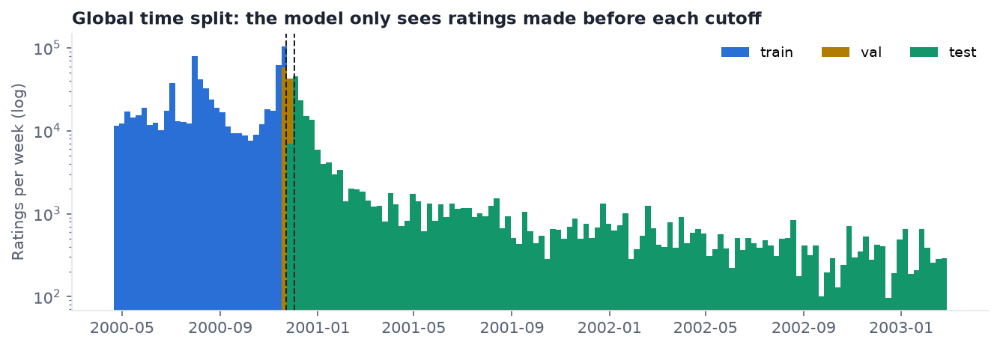
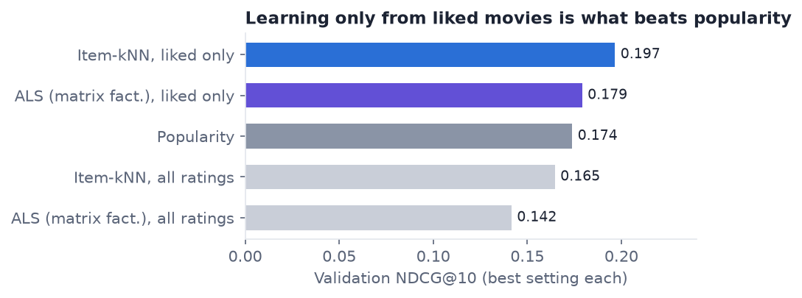
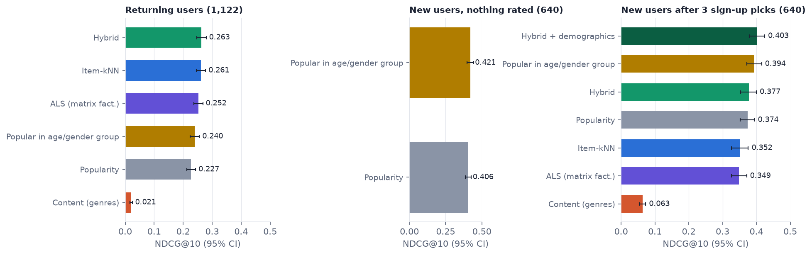
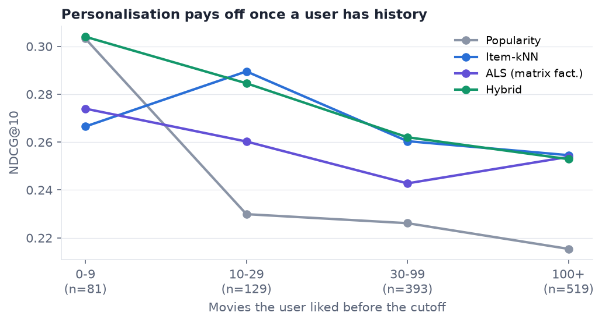

# Movie Recommender with Cold-Start Handling

> UneeQ Interns · Machine Learning Track · October 2026
> **Demo video:** [YouTube/LinkedIn link](#) · **Author:** Michael Danial

A content platform wants to put ten movies in front of each user that they will actually enjoy. This project builds
that list for MovieLens 1M: a **popularity baseline**, **collaborative filtering** (item-kNN and ALS matrix
factorisation), a **content-based** model (genres and decade), and a **hybrid** that combines them. It handles
**cold start** for new users and new movies, explains every recommendation, and is evaluated with **ranking
metrics on a time-based split**. The hybrid is served by a FastAPI endpoint and a Streamlit demo.

**Headline result (test period 2 Dec 2000 → Feb 2003, models frozen on 2 Dec 2000):**

| User group | Best model | NDCG@10 (95% CI) | Popularity baseline | Gain (paired 95% CI) |
|---|---|---|---|---|
| Returning users (1,122) | Hybrid | **0.263** (0.247–0.279) | 0.227 | **+0.036** (+0.029 to +0.043) |
| New users, nothing rated (640) | Popular in their age/gender group | **0.421** (0.399–0.443) | 0.406 | +0.015 (+0.006 to +0.024) |
| New users after 3 sign-up picks (640) | Hybrid + demographics | **0.403** (0.379–0.424) | 0.374 | +0.029 (+0.017 to +0.041) |

Two results are negative, and they are reported as they came out:

- After 3 sign-up picks, the hybrid's lead over demographic popularity *alone* is +0.009 (−0.002 to +0.020). That
  interval includes zero.
- For brand-new movies, the genre-based content model ranks them no better than chance (AUC 0.48).

---

## 1. Business problem

A recommendation slot is worth something only if people click what is in it. Showing the same blockbusters to
everyone is a strong, cheap baseline: half of all 4- and 5-star ratings go to a small head of movies. So the real
question is whether personalisation **beats "most popular" by a margin that is worth its complexity**, and what
to show people the system knows nothing about yet. A miss costs a slot that could have held a movie the user
would have watched. Recommendations also need a reason the user can read ("because you liked …"), or they are
hard to trust.

## 2. Data

- **Source:** [MovieLens 1M](https://grouplens.org/datasets/movielens/1m/), GroupLens Research, University of
  Minnesota. The licence allows research use; the data is not redistributed in this repo.
- **Size:** 1,000,209 ratings (1–5 stars) from 6,040 users on 3,706 movies, Apr 2000 → Feb 2003. It also has
  user gender, age group and occupation, and movie genres and year. 95.5% of the user × movie grid is empty.
- **Integrity:** `ml-1m.zip` MD5 is `c4d9eecfca2ab87c1945afe126590906`, which matches GroupLens. It is checked
  by `python -m src.data`.
- **"Liked"** = a rating of 4 or 5 (58% of ratings). A test rating of 1–2 stars is a *bad* recommendation, not a
  hit.

### Split: by time, never random



| Part | Ratings | Window | Used for |
|---|---|---|---|
| Train | 700,144 | → 22 Nov 2000 | fitting while tuning |
| Validation | 100,020 | 22 Nov → 2 Dec 2000 | choosing hyper-parameters and blend weights |
| Test | 200,045 | 2 Dec 2000 → 28 Feb 2003 | one final evaluation, with models refit on train + validation |

A random split would leak the future. The model would learn from ratings made *after* the ones it is tested on,
including which movies later became popular, which no deployed system can know. A global time cutoff puts every
model in the position of a recommender deployed on that date. It also produces real cold start for free:
**640 test users and 44 test movies appear only after the cutoff.** The test set was used once, after all
choices were made on validation. The one exception is described in §5.3.

## 3. Approach

```
ratings ─► time split ─► liked-only interaction matrix ─┬─► item-kNN  (cosine, top-400 neighbours, shrink 100)
                                                        ├─► ALS       (implicit MF, 16 factors, exact solve)
genres + decade ─────────────────────────────────────────┼─► content   (idf-weighted genres, user = mean of liked)
4–5★ counts (global / per age-gender group) ─────────────┴─► popularity, demographic popularity
                                                              │
               hybrid = Σ weight × min-max(score per user) ◄──┘   weights tuned on validation
                                                              │
   router: known user → hybrid · new user + picks → hybrid + demographics · nothing known → demographics/popularity
```

| Model | What it learns from | Can score a new user? | Can score a new movie? |
|---|---|---|---|
| Popularity | count of 4–5★ ratings | yes (same list for all) | no |
| Demographic popularity | 4–5★ counts within gender × age group | yes, from age + gender | no |
| Item-kNN | movies liked by the same people | from picked movies | no |
| ALS | latent taste vectors | from picked movies (fold-in) | no |
| Content | genres + decade | from picked movies | **yes** |
| **Hybrid** | kNN 1.0 · ALS 0.25 · popularity 0.5 · content 0.1 | via the router | via the content part |

All models are implemented in `src/models.py` (NumPy and SciPy, no recommender library), so every scoring step is
visible.

### The choice that mattered most: learn from liked movies only



Trained on *every* rating, both collaborative models scored **below** the popularity baseline on validation
(item-kNN 0.165, ALS 0.142 vs 0.174). A user who rated a movie 1 star is still counted as "connected" to it, so
the models learn what people *watched*, not what they *liked*. Restricting the interaction matrix to 4–5★ ratings
moves item-kNN to 0.197 and ALS to 0.179. Every setting tried is in `reports/tuning_cf.csv`, the blend weights in
`reports/tuning_hybrid.csv`, and the onboarding weights in `reports/tuning_onboard.csv`.

## 4. Results

Metrics are computed per user at K = 10 over users with at least one liked test movie, with 1,000-resample
bootstrap intervals over users. Movies the user had already rated are never recommended.



### Returning users (1,122)

| Model | NDCG@10 (95% CI) | Precision@10 | Recall@10 | MAP@10 | Hit rate | Coverage | Avg. popularity pct. |
|---|---|---|---|---|---|---|---|
| **Hybrid** | **0.263** (0.247–0.279) | **0.241** | 0.066 | **0.168** | **0.69** | 6.5% | 0.993 |
| Item-kNN | 0.261 (0.246–0.277) | 0.239 | 0.065 | 0.166 | 0.67 | 8.2% | 0.988 |
| ALS | 0.252 (0.237–0.268) | 0.228 | **0.072** | 0.155 | 0.69 | 13.4% | 0.975 |
| Demographic popularity | 0.240 (0.224–0.256) | 0.223 | 0.063 | 0.149 | 0.67 | 5.4% | 0.994 |
| Popularity (baseline) | 0.227 (0.213–0.243) | 0.211 | 0.054 | 0.141 | 0.65 | 3.3% | 0.996 |
| Content (genres) | 0.021 (0.017–0.024) | 0.020 | 0.004 | 0.008 | 0.14 | 43.3% | 0.484 |

Paired against popularity on the same users: hybrid **+0.036** (+0.029 to +0.043), item-kNN +0.034, ALS +0.025.
The hybrid's edge over item-kNN alone is +0.002, which is within noise. Almost all of the personalisation comes
from item-kNN. On a per-user basis the hybrid gets more hits than popularity for 32% of users, the same number
for 54%, and fewer for 14% (`reports/warm_user_hits.csv`).

### Where personalisation helps



For users with fewer than 10 liked movies before the cutoff, nothing beats popularity (0.303 vs hybrid 0.304).
From 10 liked movies upward, item-kNN and the hybrid lead popularity by 0.03–0.06 NDCG in every bucket.

## 5. Task criteria

### 5.1 Baseline comparison is included

Popularity is the baseline throughout: in validation tuning, in every test segment, and in every paired
difference (`reports/paired_vs_popularity.csv`). Demographic popularity is a second, stronger baseline for the
cold-start segments.

### 5.2 Recommendations are explainable enough

Every recommendation carries:

1. **A reason sentence.** For the hybrid this is "Because you liked A, B, C": the three liked movies with the
   largest item-kNN similarity to the recommendation. Popularity says how many people rated it 4+, demographic
   popularity names the group, and content names the shared genres.
2. **A score breakdown.** It shows the share of the hybrid score from *your movies* (kNN), *taste vectors* (ALS),
   *popularity* and *genres*. When popularity is the bigger part, the sentence changes to "Mostly popularity …;
   also liked by fans of X" instead of claiming a personal reason.

**How true is "because you liked X"?** I tested it on 3,000 recommendations to 300 random returning users
(`explanation_checks` in `src/evaluate.py`):

| Check | Result |
|---|---|
| Recommendations that cite at least one movie the user liked | 100% |
| Share of the item-kNN score that comes from the three cited movies | 19% |
| Recommendations that drop out of the top 10 when the three cited movies are removed from the history | 22.5% |

The explanation is true but partial. A recommendation is usually supported by dozens of the user's movies plus
popularity, and three names are a readable summary of that, not the whole cause. That is why the score breakdown
is shown next to every reason, and why the app's *Why this?* page lets you run the deletion test on any
recommendation. I'd call this "explainable enough" for a consumer UI, but not enough for an audit.

### 5.3 Cold-start scenarios are addressed

**New users (640 real ones).** The router changes route as it learns more:

| What we know | Route | NDCG@10 | vs popularity (paired) |
|---|---|---|---|
| Nothing | Popularity | 0.406 | — |
| Age + gender | Demographic popularity | **0.421** | +0.015 (+0.006 to +0.024) |
| 3 picked movies | Hybrid | 0.377 | +0.003 (−0.011 to +0.018) |
| 3 picks + age + gender | Hybrid + demographics | **0.403** | +0.029 (+0.017 to +0.041) |

For the last two rows, the first 3 movies each new user liked are treated as their sign-up picks, and the rest of
their test ratings are scored. That is a harder target than the first two rows, so compare rows within a pair.

- **What did not work.** With only 3 picks, item-kNN (0.352) and ALS (0.349) alone score *below* plain
  popularity (0.374). Three movies are not enough signal on their own.
- **Process note.** The "Hybrid + demographics" route was added *after* I saw the first test run, in which the
  plain hybrid lost to demographic popularity. Its weights were then chosen only on the *validation* window's new
  users (`reports/tuning_onboard.csv`), but this is still one decision informed by the test set.
- **Result.** Its lead over demographic popularity alone is **+0.009 (−0.002 to +0.020)**, so it is **not a
  clear improvement**. The honest conclusion: for a brand-new user, age and gender carry as much signal as three
  picks, and personalisation starts paying off at around 10 liked movies.

**New movies (44 movies first rated after the cutoff).** Collaborative models cannot score a movie with no ratings.
The content model can, and the hybrid gives it a 0.1 weight so new movies can enter a list. But when the content
model ranks only the new movies for the 37 users who liked one, its AUC is **0.48 (0.42–0.54)**, which is chance
level. Genre and decade alone do not predict which new movie someone will like. This is the weakest part of the
system (see §6).

## 6. Limitations and next steps

- **Item cold start is not solved.** The fix needs richer movie metadata: plot or cast embeddings, or a text
  model over descriptions. Alternatively, an *exploration slot* could show new titles to a small share of users to
  collect first ratings quickly.
- **Popularity bias.** Every model except content recommends blockbusters (average popularity percentile above
  0.97), and the hybrid uses only 6.5% of the catalogue. A diversity or long-tail re-ranking step would trade a
  little NDCG for coverage. That trade-off is not explored here.
- **Ratings are not exposure.** MovieLens users rate movies they *chose* to rate, often in bulk. Offline NDCG is
  a proxy, and only an online A/B test (click-through and watch time) measures the real effect.
- **One dataset and one period.** 75% of ratings were made in 2000. The test period is long (to 2003), but tastes
  and the catalogue in 2000 are not today's.
- **The hybrid ≈ item-kNN.** The blend adds +0.002 over item-kNN alone. In production I would ship item-kNN plus
  popularity (simpler and equally explainable) unless the ALS part earns its keep in an online test.
- **Reproducibility.** Results were produced by one run, in the order `data → tune → evaluate → figures`. Rerunning
  on another machine can move the third decimal (about ±0.003), because ties in the top-K and floating-point
  summation order differ. None of the conclusions above depend on that digit.

## 7. API

```bash
uvicorn api.main:app --reload        # interactive docs at http://localhost:8000/docs
```

| Endpoint | Purpose |
|---|---|
| `GET /health` | model loaded, number of users and movies, parameters |
| `GET /recommend/{user_id}?k=10&model=hybrid` | top-K for a known user (also `item_knn`, `als`, `content`, `popularity`) |
| `POST /recommend/new-user` | cold start: `{"liked_movie_ids": [2571, 1196, 260], "gender": "M", "age": 18}` |
| `GET /similar/{movie_id}` | "people who liked this also liked" (item-kNN neighbours) |

Each recommendation returns `title`, `year`, `genres`, `score`, `reason`, `because` (cited movie ids), the
`model` route actually used, and `drivers` (the score breakdown). Unknown users get a 404 that points to the
new-user endpoint, and invalid movie ids or age codes get a 422.

## 8. Demo app

**30-second silent walkthrough:** [`demo/recommender_demo.mp4`](demo/recommender_demo.mp4). It is a real recording
of this app, scripted with Playwright on a virtual display by `demo/record.py` and edited by `demo/build.py`.

```bash
streamlit run app.py                 # http://localhost:8501
```

| Page | What it shows |
|---|---|
| **For you** | A real returning user's liked movies, the hybrid's top 10 (with reasons and score bars) next to the popularity list. The *Hindsight* toggle marks the movies they rated 4+ after the cutoff. |
| **New user** | Pick gender, age group and up to 3 movies. The route and the list change live: popularity → demographics → hybrid + demographics. |
| **Results** | Every model per segment with 95% intervals, all ranking metrics, the by-history curve, paired differences and the new-movie AUC. |
| **Why this?** | The score breakdown of any recommendation, which liked movies point to it, and a live deletion test. |
| **The data** | The time split, why it is not random, the long tail, and the two choices that mattered. |

## 9. How to run

```bash
# 1. Environment (Python 3.12)
uv venv --python 3.12 && source .venv/bin/activate
uv pip install -r requirements.txt

# 2. Data → data/raw/
#    download https://files.grouplens.org/datasets/movielens/ml-1m.zip into data/raw/ and unzip it there
#    (gives data/raw/ml-1m/{ratings,movies,users}.dat)

# 3. Pipeline (about 2 minutes on a laptop CPU)
python -m src.data                   # checksum + time split → data/processed/
python -m src.tune --stage cf        # validation only → reports/tuning_cf.csv
python -m src.tune --stage hybrid    #                  → reports/tuning_hybrid.csv
python -m src.tune --stage onboard   #                  → reports/tuning_onboard.csv
python -m src.evaluate               # refit on train+val, test once → models/, reports/
python -m src.figures                # → reports/figures/

# 4. Use it
streamlit run app.py
uvicorn api.main:app --reload

# 5. Tests (metrics by hand, every app page renders, hindsight + cold-start routing)
pytest -q
```

## 10. Repository layout

```
├── api/main.py              # FastAPI: /recommend, /recommend/new-user, /similar, /health
├── app.py                   # Streamlit entry point (5 pages in app_pages/, shared UI in app_lib/)
├── src/
│   ├── config.py            # paths, cutoffs, K, "liked" threshold
│   ├── data.py              # load, checksum, time split
│   ├── models.py            # popularity, demographic popularity, item-kNN, ALS, content
│   ├── pipeline.py          # Recommender: fits all models, hybrid, cold-start router, explanations
│   ├── metrics.py           # precision/recall/NDCG/MAP/hit rate, coverage, bootstrap CIs
│   ├── tune.py              # validation-only hyper-parameter and blend-weight search
│   ├── evaluate.py          # single test run: segments, paired diffs, item cold start, explanation checks
│   └── figures.py           # README figures
├── reports/                 # metrics.csv, paired_vs_popularity.csv, by_history.csv, tuning_*.csv,
│                            # summary.json, warm_user_hits.csv, figures/
├── demo/                    # recommender_demo.mp4 + record.py / build.py that made it
├── tests/                   # test_metrics.py, test_app.py
├── data/                    # raw/ and processed/ (gitignored)
└── models/                  # recommender.joblib (gitignored, rebuilt by src.evaluate)
```

## Citation

F. Maxwell Harper and Joseph A. Konstan. 2015. *The MovieLens Datasets: History and Context.* ACM Transactions on
Interactive Intelligent Systems 5, 4, Article 19. https://doi.org/10.1145/2827872

Y. Hu, Y. Koren and C. Volinsky. 2008. *Collaborative Filtering for Implicit Feedback Datasets.* ICDM 2008.
